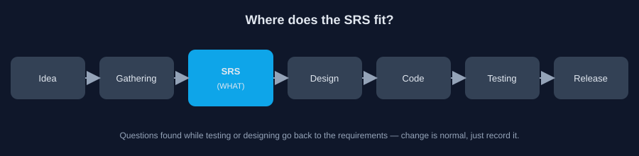
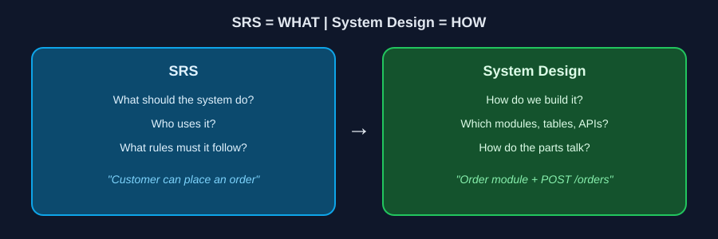

# 01 — يعني إيه SRS؟

> ⏱️ 3 دقايق

## المشكلة

عميل قالك: *"عايز موقع E-commerce، الناس تشتري والأدمن يدير الطلبات."*

تبدأ كود؟ لسه. مش عارف:

- العميل لازم يعمل Account ولا يشتري كـ Guest؟
- المخزون بيتخصم إمتى؟
- لو الدفع فشل نعمل إيه؟

لو بدأت من غير إجابات، هتبني على **افتراضاتك**، والافتراض الغلط معناه إعادة شغل.

## الحل: SRS

**SRS = Software Requirements Specification**

وثيقة بتقول النظام **المفروض يعمل إيه**، ومين هيستخدمه، وإيه القواعد اللي بتحكمه. بدل ما الفكرة تفضل كلام في Meeting، بتتحول لمكتوب الكل يرجعله: الـ Business والـ Devs والـ QA.

## SRS مش System Design

- **SRS:** إيه المطلوب؟
- **System Design:** هنبنيه إزاي؟ (ده Part 03)

## ليه بنحتاجها؟

- **فهم واحد للفريق:** "المستخدم يلغي الطلب" ممكن كل واحد يفهمها بشكل مختلف.
- **Scope واضح:** إيه اللي داخل الإصدار الأول وإيه اللي لأ.
- **شغل أقل بعد كده:** بتكتشف المشاكل قبل الكود مش بعده.

## جوه الـ SRS فيه إيه؟

مفيش Template واحد، بس غالبًا هتلاقي:

| القسم | بيجاوب على إيه؟ |
|---|---|
| **Purpose** | الوثيقة دي عن إيه؟ |
| **Scope** | المشروع بيعمل إيه وإيه اللي برا حدوده؟ |
| **Users / Actors** | مين هيستخدم النظام؟ |
| **Functional Requirements** | النظام يعمل إيه؟ |
| **Non-Functional Requirements** | بإيه جودة؟ (سرعة، أمان) |

> 💡 التغيير في المتطلبات طبيعي. المهم يتسجل ويتوافق عليه، مش يحصل بالصدفة.

⬅️ [الرئيسية](../README.md) | التالي ➡️ [02 — المصطلحات الستة](./02-six-terms.md)
