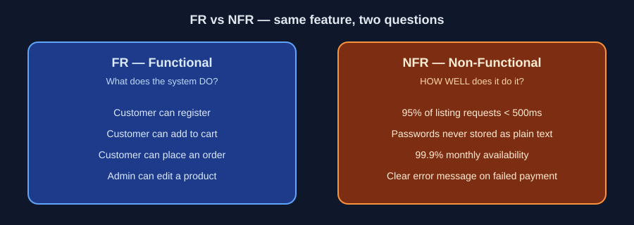
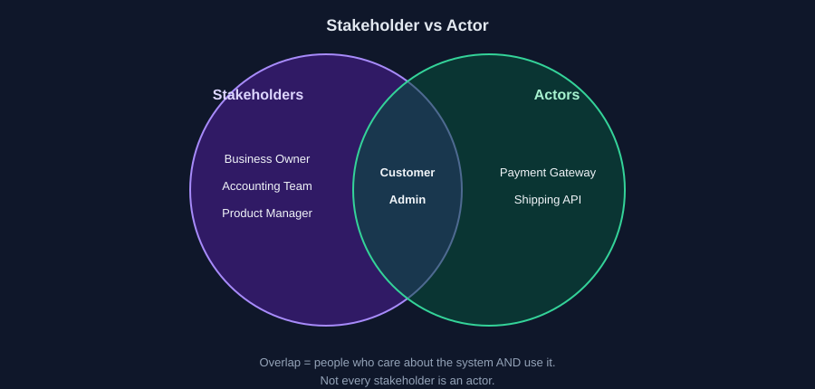

# 02 — 6 مصطلحات تفهم بيهم أي SRS

> ⏱️ 5 دقايق

## 1) FR — Functional Requirements

النظام **يعمل إيه**.

> العميل يقدر يضيف منتج للـ Cart.

❌ "النظام يدير الطلبات بكفاءة" (مش قابلة للاختبار)
✅ "الأدمن يقدر يعرض الطلبات ويبحث برقم الطلب"

## 2) NFR — Non-Functional Requirements

النظام يشتغل **بإيه جودة**.

❌ "النظام لازم يكون سريع"
✅ "95% من طلبات عرض المنتجات تستجيب في أقل من 500ms" *(الرقم مثال)*

## 3) Actor

شخص أو **نظام خارجي** بيتفاعل مع النظام.

مثال: Customer, Admin, **Payment Gateway**.

## 4) Stakeholder

أي حد **ليه مصلحة** في المشروع، حتى لو مش بيستخدمه.

مثال: صاحب المتجر، فريق الحسابات.

> مش كل Stakeholder هو Actor.

## 5) Use Case

سيناريو: Actor عايز يحقق هدف.

**Place an Order:**
- **Main Flow:** كل حاجة تمشي صح → الطلب يتسجل.
- **Alternative Flow:** اختار الدفع عند الاستلام.
- **Exception Flow:** المخزون مش كافي.

## 6) Business Rule + Acceptance Criteria

| | بتقول إيه؟ | مثال |
|---|---|---|
| **Business Rule** | القاعدة اللي بتحكم الوظيفة | الإلغاء مسموح قبل خروج الطلب للتوصيل بس |
| **Acceptance Criteria** | إزاي نعرف إن الـ Feature خلصت صح | **Given** منتج متاح **When** ضغط Add to Cart **Then** يظهر في الـ Cart بالسعر الصحيح |

---

⬅️ [01](./01-what-is-srs.md) | التالي ➡️ [03 — إزاي تقرا SRS](./03-how-to-read-srs.md)
