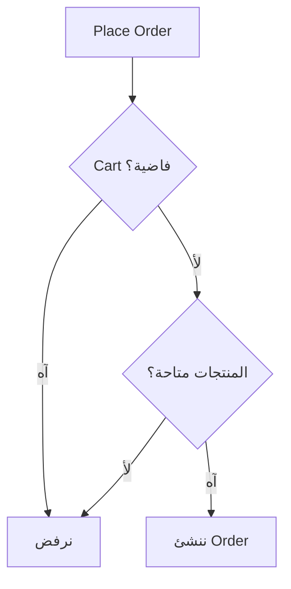

# 03 — إزاي تقرا SRS من غير ما تتوه؟

> ⏱️ 4 دقايق

مسكت SRS من 80 صفحة؟ متبدأش تقرا كل كلمة. اتبع الخطوات دي:

1. **الصورة العامة:** Purpose + Scope + المستخدمين. واكتب ملخص من 3 سطور.
2. **افهم الـ Business:** مين بيدفع؟ الفلوس بتتحرك إزاي؟
3. **حدد الـ Actors والـ Modules:** Auth, Products, Cart, Orders, Payments...
4. **حلل كل Requirement** (المثال تحت).
5. **سجل أسئلتك** في Question Log. **متفترضش.**
6. **اختبر نفسك:** تقدر تشرح المشروع من غير ما تفتح الملف؟

## مثال: حلل Requirement واحدة

> **REQ-ORD-001:** العميل اللي عامل Login ينشئ Order من منتجات الـ Cart.

| اسأل | الإجابة |
|---|---|
| مين الـ Actor؟ | Authenticated Customer |
| إيه اللي بيبدأ العملية؟ | يضغط Place Order |
| الشروط المسبقة؟ | Login + Cart مش فاضية + المنتجات متاحة |
| لو حاجة فشلت؟ | Cart فاضية / منتج خلص / شحن ناقص → نرفض ونوضح |

## هل جاهزة للكود؟ لسه!

فيه أسئلة محتاجة قرار من الـ Business. سجلها:

| ID | السؤال | ليه مهم؟ |
|---|---|---|
| Q-01 | المخزون بيتخصم إمتى؟ | بيأثر على Orders وInventory |
| Q-02 | لو الدفع فشل، الطلب يفضل Pending ولا يتلغى؟ | بيأثر على الحالات والـ Refund |
| Q-03 | السعر بيتثبت وقت الـ Cart ولا وقت الـ Order؟ | بيأثر على تصميم الـ Database |

> 💡 أسئلة زي "اتضغط مرتين؟" و"عميلين اشتروا آخر قطعة؟" هنحلها في **Part 05**.

---

⬅️ [02](./02-six-terms.md) | التالي ➡️ [04 — Cheat Sheet](./04-cheat-sheet.md)
