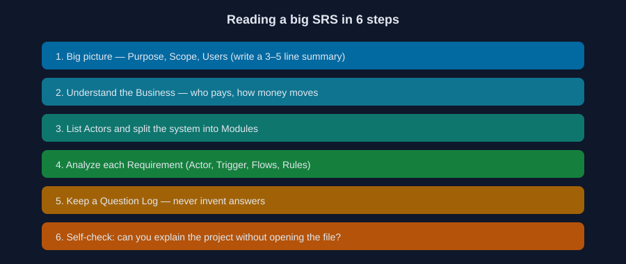
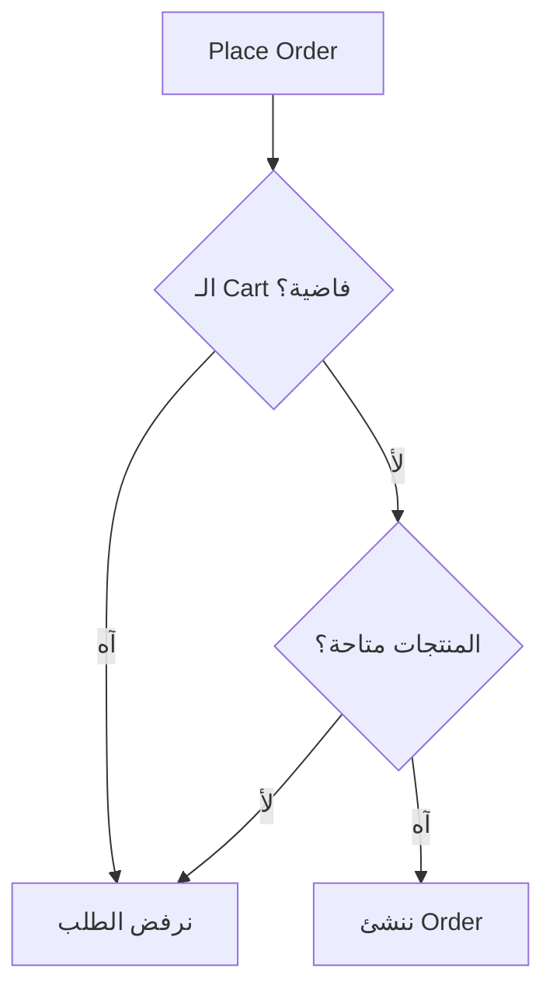

# 03 — إزاي تقرا SRS من غير ما تتوه؟

وقت القراءة: 5 دقايق

استلمت SRS من 80 صفحة. أكبر غلطة إنك تقراها كلمة كلمة، أو تبدأ تنفذ أول Feature تقابلك. الأفضل تقراها على خطوات:

1. **الصورة العامة:** اقرأ الـ Purpose والـ Scope والمستخدمين، واكتب ملخص من 3 سطور للمشروع.
2. **افهم الـ Business:** مين بيدفع؟ الفلوس بتتحرك إزاي؟ إيه العمليات الأساسية؟
3. **حدد الـ Actors والـ Modules:** زي Authentication وProducts وCart وOrders وPayments.
4. **حلل كل Requirement:** هنطبق عليها مثال تحت.
5. **سجل أسئلتك في Question Log:** أي حاجة مش واضحة تتكتب كسؤال. متفترضش إجابة من عندك.
6. **اختبر فهمك:** تقدر تشرح المشروع لحد من غير ما تفتح الوثيقة؟

## مثال: تحليل Requirement واحدة

> REQ-ORD-001: العميل اللي عامل Login يقدر ينشئ Order من المنتجات المتاحة في الـ Cart.

| السؤال | الإجابة |
|---|---|
| مين الـ Actor؟ | Authenticated Customer |
| إيه اللي بيبدأ العملية؟ | العميل يضغط Place Order |
| الشروط المسبقة؟ | عامل Login، والـ Cart مش فاضية، والمنتجات متاحة |
| لو حاجة فشلت؟ | Cart فاضية أو منتج خلص أو بيانات شحن ناقصة، فنرفض ونوضح السبب |

## هل المتطلب ده جاهز للكود؟

لسه. لأن فيه قرارات محتاجة تتاخد من الـ Business، وبتأثر مباشرة على التصميم. سجلها في Question Log:

| ID | السؤال | ليه محتاجين نعرف؟ |
|---|---|---|
| Q-01 | المخزون بيتخصم إمتى؟ | بيأثر على Orders وInventory |
| Q-02 | لو الدفع فشل، الطلب يفضل Pending ولا يتلغى؟ | بيأثر على حالات الطلب والـ Refund |
| Q-03 | السعر بيتثبت وقت الـ Cart ولا وقت الـ Order؟ | بيأثر على تصميم الـ Database |

وفيه حالات تانية زي إن العميل يضغط Place Order مرتين، أو عميلين يشتروا آخر قطعة في نفس اللحظة. دي اسمها Edge Cases، وهنتعامل معاها في Part 05.

---

السابق: [02](./02-six-terms.md) | الملف التالي: [04 — Cheat Sheet](./04-cheat-sheet.md)
