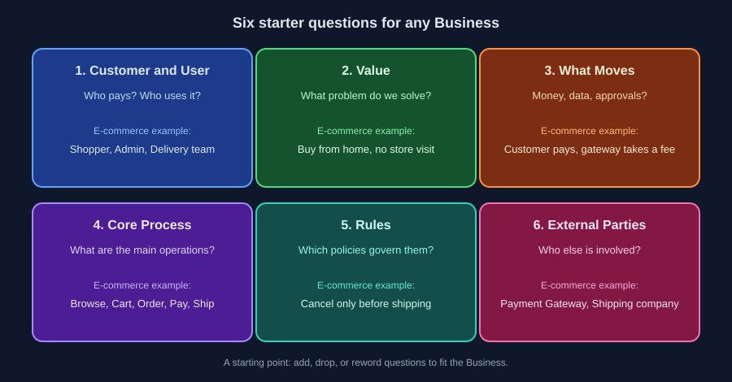

# 02 — ست أسئلة تبدأ بيها لفهم أي Business

وقت القراءة: 6 دقايق

فيه ست أسئلة بتساعدك تبدأ تفهم أي Business، مهما كان مجاله. دي مش قايمة ثابتة تتطبق بالحرف، دي نقطة بداية: زوّد منها أو شيل حسب الـ Business اللي قدامك (هنوضح ده في آخر الملف). لو جاوبت عليهم يبقى عندك صورة كافية تبدأ منها.

## 1) مين العميل ومين المستخدم؟

العميل (Customer) هو اللي بيدفع، والمستخدم (User) هو اللي بيستخدم النظام. وأوقات بيكونوا شخصين مختلفين: في نظام لشركة، الشركة هي اللي بتدفع، والموظفين هم اللي بيستخدموه.

في الـ E-commerce: العميل بيشتري، والأدمن بيدير المنتجات، وفريق التوصيل بينفذ الطلبات.

## 2) بنحل مشكلة إيه؟

ده الـ Value، يعني ليه الناس هتستخدم الخدمة دي أصلًا. من غير إجابة واضحة هتبني Features محدش محتاجها.

في الـ E-commerce: العميل يشتري من بيته من غير ما ينزل، والتاجر يوصل لعملاء أكتر من محله.

## 3) إيه اللي بيتحرك؟

في أغلب الـ Business اللي بيتحرك هو الفلوس، فاسأل: مين بيدفع؟ لمين؟ إمتى؟ وفين بتتاخد رسوم أو عمولة؟ ده بيحدد شكل الـ Payments والـ Refunds والتقارير.

لكن مش كل نظام فيه فلوس. لو مفيش، اسأل نفس السؤال بصيغة تانية: إيه اللي بيتحرك بين الناس والنظام؟ ممكن يكون بيانات، أو طلبات، أو موافقات، أو وقت. في نظام إجازات داخلي مثلًا: الموظف يقدم طلب، المدير يوافق، والرصيد يتخصم. ولو التطبيق مجاني، اسأل برضو إيه اللي بيمول الشغل (إعلانات؟ جهة راعية؟)، لأنه بيأثر على اللي هيتبني.

في الـ E-commerce: العميل يدفع، والـ Payment Gateway بيخصم رسوم، والباقي بيوصل للتاجر.

## 4) إيه العمليات الأساسية؟

الرحلة من أولها لآخرها: إيه اللي بيحصل من أول ما العميل يدخل لحد ما ياخد الخدمة.

في الـ E-commerce: تصفح، Cart، Order، دفع، شحن، توصيل.

## 5) إيه القواعد اللي بتحكم الشغل؟

دي الـ Business Rules اللي عرفناها في Part 01: سياسات الإلغاء والاسترجاع والخصومات والحدود.

في الـ E-commerce: الإلغاء مسموح قبل الشحن بس، والاسترجاع خلال عدد أيام معين. والرقم ده قرار الـ Business مش المبرمج.

## 6) مين الأطراف التانية؟

أي جهة برا النظام بيعتمد عليها الشغل: Payment Gateway، شركة شحن، خدمة SMS، أو أنظمة قديمة.

في الـ E-commerce: الـ Payment Gateway وشركة الشحن.

> لو معرفتش إجابة سؤال منهم، ده مش فشل. ده أول سطر في الـ Question Log.

## الأسئلة دي نقطة بداية مش قايمة ثابتة

زوّد منها أو شيل حسب الـ Business:

- **سؤال مش منطبق؟** متسيبوش فاضي. اكتب "مش منطبق" وليه، لأن ده نفسه معلومة عن الـ Business.
- **سؤال ناقص؟** زوّده. أمثلة: فيه قوانين أو تراخيص لازم نلتزم بيها؟ حجم الاستخدام المتوقع قد إيه؟ إيه اللي يعتبر نجاح للمشروع؟

---

السابق: [01](./01-why-business-first.md) | الملف التالي: [03 — الفلوس ورحلة الطلب](./03-money-and-order-flow.md)

