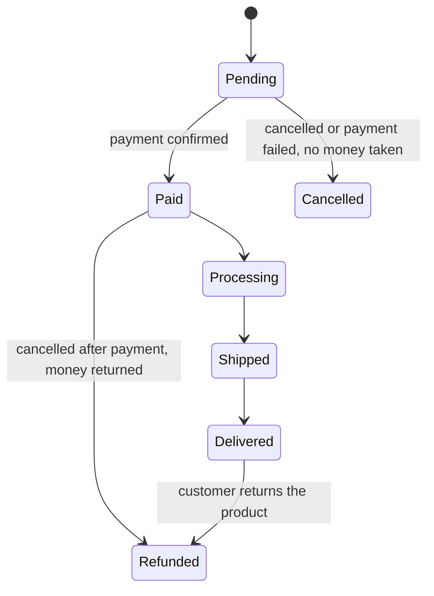

# 03 — الفلوس ورحلة الطلب: تطبيق على E-commerce

وقت القراءة: 5 دقايق

هنطبق السؤالين 3 و4 على E-commerce، لأنهم أكتر أسئلة بتأثر على التصميم.

## الفلوس بتتحرك إزاي؟

في الدفع الأونلاين، العميل بيدفع للـ Payment Gateway، والـ Gateway بيحول للمتجر بعد ما يخصم رسومه. أما في الدفع عند الاستلام (COD)، فالفلوس بتتحصل مع المندوب وبتوصل للمتجر بعد كده. الفرق ده مهم، لأن في COD الطلب بيتسجل قبل ما أي فلوس توصل.

الرسوم ومدة التحويل بتختلف حسب مزود الدفع والعقد، فمتفترضش رقم.

## رحلة الطلب: Order Status

أفضل طريقة تفهم بيها العمليات إنك ترسم حالات الطلب (Order Statuses). كل حالة هي مرحلة في حكاية الـ Business:

الحالات دي مثال للتوضيح، والقرار النهائي للـ Business.

لاحظ إن فيه طريقين لحالة Refunded، والسبب مختلف في كل واحد:

- **من Paid:** العميل دفع والطلب اتلغى قبل ما يتسلم، فالفلوس بترجع من غير ما فيه منتج يرجع.
- **من Delivered:** العميل استلم المنتج وبعدين رجّعه، فالفلوس بترجع بعد ما المنتج يرجع المخزون ويتفحص.

والرسمة سايبة سؤال مقصود: لو الطلب اتلغى وهو في Processing أو Shipped، يروح فين؟ ده قرار Business، ومكانه الـ Question Log.

## الرسمة بتجاوب على أسئلة Part 01

بدل ما نسأل في الهوا "الإلغاء مسموح لحد إمتى؟"، بقى عندنا خريطة نسأل عليها:

- الإلغاء مسموح لحد أنهي حالة؟
- المخزون بيتخصم عند الانتقال لأنهي حالة؟
- لو الدفع فشل، الطلب بيروح فين؟

وخلي بالك إن كل Status لازم يكون متفق عليه، لأن الـ Frontend والـ Backend والـ QA والأدمن كلهم هيتعاملوا معاه.

---

السابق: [02](./02-six-questions.md) | الملف التالي: [04 — Cheat Sheet](./04-cheat-sheet.md)

