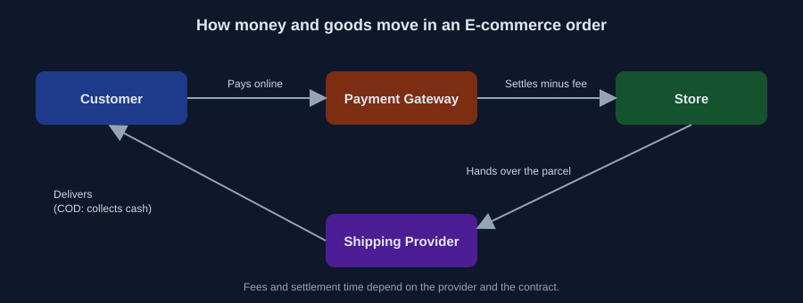
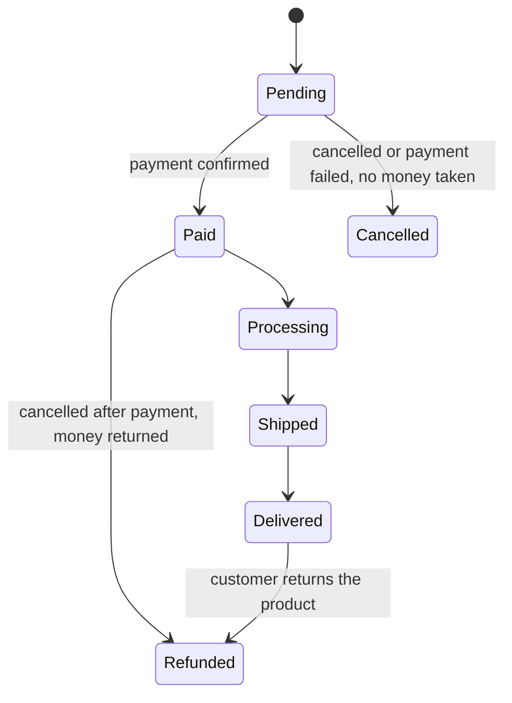

# 03 — الفلوس ورحلة الطلب: تطبيق على E-commerce

وقت القراءة: 5 دقايق

هنطبق السؤالين 3 و4 على E-commerce، لأنهم أكتر أسئلة بتأثر على التصميم.

## الفلوس بتتحرك إزاي؟

في الدفع الأونلاين، العميل بيدفع للـ Payment Gateway، والـ Gateway بيحول للمتجر بعد ما يخصم رسومه. أما في الدفع عند الاستلام (COD)، فالفلوس بتتحصل مع المندوب وبتوصل للمتجر بعد كده. الفرق ده مهم، لأن في COD الطلب بيتسجل قبل ما أي فلوس توصل.

الرسوم ومدة التحويل بتختلف حسب مزود الدفع والعقد، فمتفترضش رقم.

## رحلة الطلب: Order Status

أفضل طريقة تفهم بيها العمليات إنك ترسم حالات الطلب (Order Statuses). كل حالة هي مرحلة في حكاية الـ Business:

الحالات دي مثال للتوضيح، والقرار النهائي للـ Business.

لاحظ إن فيه طريقين لحالة Refunded، والسبب مختلف في كل واحد:

- **من Paid:** العميل دفع والطلب اتلغى قبل ما يتسلم، فالمتجر يرجّع للعميل فلوسه. ومفيش منتج يرجع، لأن العميل أصلًا مستلمش حاجة.
- **من Delivered:** العميل استلم المنتج وبعدين قرر يرجّعه (المقاس غلط، أو فيه عيب، أو غيّر رأيه)، فالمتجر ياخده ويرجّع للعميل فلوسه. والمنتج بيرجع المخزون بعد ما يتفحص.

الفلوس بترجع للعميل بنفس طريقة الدفع الأصلية لو دفع أونلاين (عن طريق الـ Payment Gateway). أما في الدفع عند الاستلام (COD) فبالطريقة اللي المتجر متفق عليها، زي تحويل أو كاش.

والإرجاع بعد الاستلام بيفتح أسئلة للـ Business:

- الإرجاع مسموح خلال كام يوم من الاستلام؟
- مسموح لأي سبب ولا لأسباب معينة (عيب، مقاس غلط)؟
- مين بيدفع شحن الإرجاع؟
- الفلوس بترجع قبل ما المنتج يوصل ولا بعد فحصه؟

والرسمة سايبة سؤال مقصود: لو الطلب اتلغى وهو في Processing أو Shipped، يروح فين؟ ده قرار Business، ومكانه الـ Question Log.

## الرسمة بتجاوب على أسئلة Part 01

بدل ما نسأل في الهوا "الإلغاء مسموح لحد إمتى؟"، بقى عندنا خريطة نسأل عليها:

- الإلغاء مسموح لحد أنهي حالة؟
- المخزون بيتخصم عند الانتقال لأنهي حالة؟
- لو الدفع فشل، الطلب بيروح فين؟

وخلي بالك إن كل Status لازم يكون متفق عليه، لأن الـ Frontend والـ Backend والـ QA والأدمن كلهم هيتعاملوا معاه.

---

السابق: [02](./02-six-questions.md) | الملف التالي: [04 — Cheat Sheet](./04-cheat-sheet.md)

