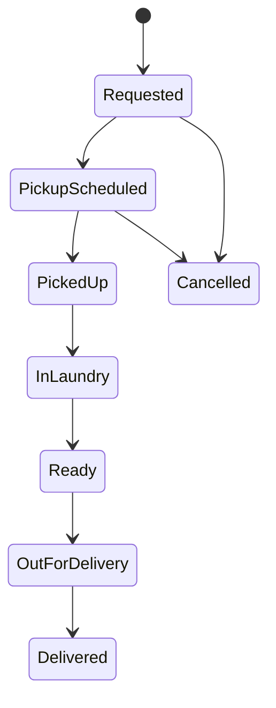

# 06 — الحل

ده حل نموذجي، مش الإجابة الوحيدة الصح. لو لقيت نقطة زيادة عن اللي هنا، ده ممتاز.

## 1) الأسئلة الست

| السؤال | الإجابة |
|---|---|
| العميل والمستخدم | العميل بيطلب ويدفع. المستخدمين: العميل، المندوب، موظف المغسلة، الأدمن |
| المشكلة اللي بنحلها | العميل يوفر وقته، مفيش نزول للمغسلة ولا انتظار |
| اللي بيتحرك (الفلوس) | العميل يدفع حسب الوزن ونوع الغسيل، كاش للمندوب أو أونلاين. الاشتراكات الشهرية دخل ثابت، والتعويضات تكلفة |
| العمليات الأساسية | طلب استلام، استلام ووزن، غسيل، توصيل، دفع |
| القواعد | التسعير بالوزن والنوع، خصم الاشتراك، التعويض عند التلف |
| الأطراف التانية | Payment Gateway، خدمة الإشعارات (SMS أو غيرها) |

## 2) حالات الطلب

ملاحظة: حالة الدفع (Paid أو Unpaid) ممكن تتفصل عن حالة الطلب، لأن الكاش بيتحصل في وقت مختلف حسب اختيار العميل.

## 3) أسئلة للـ Business

| ID | السؤال | ليه محتاجين نعرف؟ |
|---|---|---|
| Q-01 | السعر بيتحدد بعد الوزن. لو العميل رفض السعر، الطلب يتلغي ولا يكمل؟ | بيأثر على حالات الطلب وعلى الإلغاء |
| Q-02 | الإلغاء مسموح لحد أنهي حالة؟ | الحالات والاسترجاع |
| Q-03 | التعويض بيتحسب إزاي، ومين بيوافق عليه؟ | Business Rule مالية وبتحتاج صلاحيات |
| Q-04 | الاشتراك الشهري ليه حد أقصى للوزن؟ وإيه اللي يحصل لو زاد أو لو مستهلكش؟ | بيحدد حساب الخصم والترحيل |
| Q-05 | الكاش اللي مع المندوب بيتسلم للمغسلة إمتى؟ | بيأثر على المحاسبة والتقارير |

## 4) التفكير الإضافي

في نظام إجازات داخلي من غير فلوس، سؤال الفلوس بيتبدل بـ "إيه اللي بيتحرك؟": طلبات الإجازة، وموافقة المدير، ورصيد الإجازات اللي بيتخصم. والأسئلة الباقية بتفضل تقريبًا زي ما هي: العميل هو الشركة، والمستخدمين هم الموظفين والمديرين، والقواعد زي "الإجازة محتاجة موافقة" و"الرصيد ميبقاش بالسالب" (أمثلة).

## اللي خدته من الجزء ده

- فيه ست أسئلة نبدأ بيها لفهم أي Business، وبتزود منها أو تشيل حسب الحالة.
- حالات الطلب هي أسهل طريقة تشوف بيها العمليات كلها في رسمة واحدة.
- أغلب الغموض اللي بتلاقيه هو قرارات Business، ومكانه الـ Question Log.

الجزء الجاي: System Design.

---

السابق: [05](./05-exercise.md) | الرئيسية: [README](../README.md)

