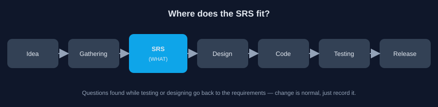
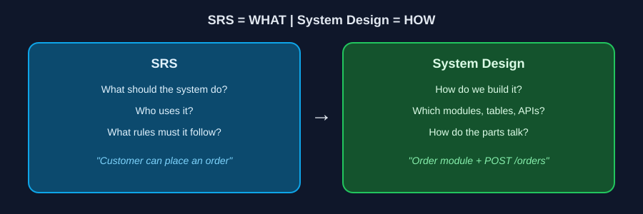

# 01: What Is an SRS?

Reading time: 4 minutes

## The Problem

A client comes to you and says: "I want an E-commerce website where people can buy products, and the admin can manage products and orders."

That describes an idea, but it isn't enough to start coding. You still don't know:

- Must the customer create an account, or can they check out as a guest?
- When is stock deducted?
- If payment fails, what happens to the order?

If you start without answers, you will build on assumptions of your own, and a wrong assumption usually costs you a redesign later.

## How Does an SRS Help?

SRS stands for Software Requirements Specification. It is a document that describes what the system should do, who will use it, and which rules govern it.

Instead of leaving the idea as talk in a meeting, it becomes written requirements that the Business, Developers, and QA can all refer back to.

The SRS comes after requirements gathering and before design and implementation. That does not mean requirements never change. Change is normal; what matters is that it is recorded and agreed on, instead of happening by accident.

## SRS vs. System Design

The two are related, but they answer different questions. The SRS says **what is needed**. System Design says **how we will build it**. Design is the topic of Part 03.

## Why Do We Need It?

**One shared understanding.** A sentence like "the user can cancel an order" can be read one way by the Backend developer, another way by the Frontend developer, and a third way by QA. The SRS gives everyone a single reference.

**A clear Scope.** You know what is in the first release and what is postponed, so you don't add features mid-project without weighing their impact.

**Cheaper change.** Finding a problem while reading the requirements costs far less than finding it after the code and the database are built.

## What Is Inside an SRS?

There is no single template every company follows, but you will usually find these sections:

| Section | What it answers |
|---|---|
| Purpose | What is this document about? |
| Scope | What does the project do, and what is outside its boundaries? |
| Users / Actors | Who will use the system? |
| Functional Requirements | What must the system do? |
| Non-Functional Requirements | At what level of quality? (speed, security) |

The next file explains these terms and more in detail.

---

Home: [README](../README.md) | Next: [02: Six Terms](./02-six-terms.md)
