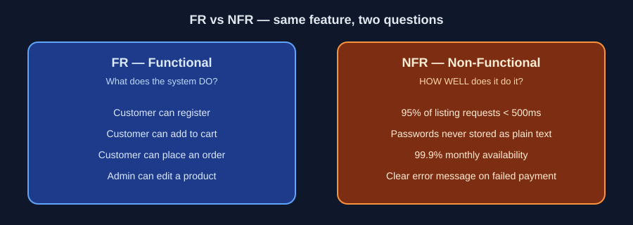
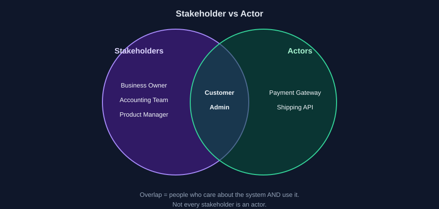

# 02: Six Terms That Unlock Any SRS

Reading time: 6 minutes

You will run into these terms in almost every SRS. Once you understand them, you know what to look for while reading the document.

## 1) FR: Functional Requirements

Functional requirements describe **what the system must do**: the functions that a user or another system expects from it.

Example: "A customer can add a product to the cart."

A good requirement is specific and testable. A sentence like "the system manages orders efficiently" is vague, because there is no way to measure "efficiently". A clearer version: "An admin can view the orders list, search by order number, and view order details."

## 2) NFR: Non-Functional Requirements

An FR says what the system does. An NFR says **at what level of quality** it does it: performance, security, availability, scalability.

"The system must be fast" is not a real NFR. It needs a condition you can measure, such as: "95% of product listing requests respond in under 500ms under a defined test load." The number here is only an illustration; the actual value is decided by the Business for each project.

## 3) Actor

Any person or **external system** that interacts with the system to achieve a goal. Examples: Customer, Admin, Payment Gateway.

Note that an Actor does not have to be a human. The Payment Gateway sends your system the result of a payment, so it is an Actor.

## 4) Stakeholder

Any person or party who **has an interest** in the project or is affected by its outcome, even if they never use the system. Examples: the store owner, the accounting team, the delivery team.

Not every Stakeholder is an Actor. The store owner cares about the project's success but does not necessarily open the system. The customer is both.

## 5) Use Case

A scenario describing an Actor using the system to achieve a specific goal. Take Place an Order:

- **Main Flow:** everything goes right, so the order is recorded.
- **Alternative Flow:** the customer chose Cash on Delivery instead of paying online.
- **Exception Flow:** stock is insufficient, or the payment service is unavailable.

A Use Case also usually states its Preconditions: what must be true before the operation starts, such as the customer being logged in.

## 6) Business Rule vs. Acceptance Criteria

These two get mixed up often, so let's separate them:

| | What it says | Example |
|---|---|---|
| Business Rule | The rule that governs a function | Cancellation is allowed only before the order is handed to delivery |
| Acceptance Criteria | How we know the feature was built correctly | Given: an available product. When: the customer clicks Add to Cart. Then: the product appears in the cart with the correct price |

A Business Rule directly shapes the Business Logic in your code, so pay close attention to it. Acceptance Criteria are what QA uses to say the work is done.

---

Previous: [01](./01-what-is-srs.md) | Next: [03: How to Read an SRS](./03-how-to-read-srs.md)
