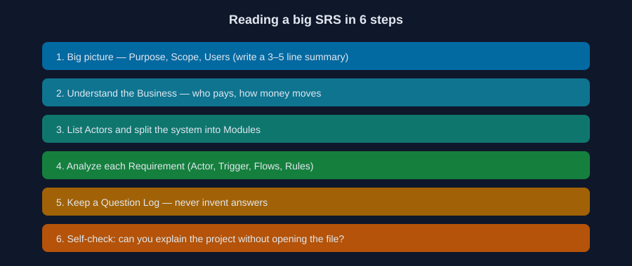
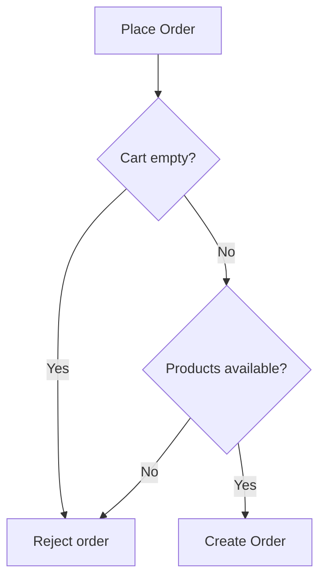

# 03: How to Read an SRS Without Getting Lost

Reading time: 5 minutes

You receive an 80-page SRS. The biggest mistake is reading it word by word, or starting to implement the first feature you see. It is better to read it in steps:

1. **The big picture:** read the Purpose, Scope, and users, and write a 3-line summary of the project.
2. **Understand the Business:** who pays? How does money move? What are the core operations?
3. **Identify the Actors and Modules:** such as Authentication, Products, Cart, Orders, and Payments.
4. **Analyze each Requirement:** we apply this to an example below.
5. **Record your questions in a Question Log:** anything unclear gets written down as a question. Do not invent an answer.
6. **Test your understanding:** can you explain the project to someone without opening the document?

## Example: Analyzing One Requirement

> REQ-ORD-001: A logged-in customer can create an Order from the available products in their Cart.

| Question | Answer |
|---|---|
| Who is the Actor? | Authenticated Customer |
| What starts the process? | The customer clicks Place Order |
| Preconditions? | Logged in, the Cart is not empty, and the products are available |
| What if something fails? | Empty Cart, out-of-stock product, or missing shipping details: reject and explain why |

## Is This Requirement Ready for Code?

Not yet. Some decisions still have to come from the Business, and they directly affect the design. Record them in a Question Log:

| ID | Question | Why do we need to know? |
|---|---|---|
| Q-01 | When is stock deducted? | Affects Orders and Inventory |
| Q-02 | If payment fails, does the order stay Pending or get cancelled? | Affects order statuses and Refunds |
| Q-03 | Is the price locked when the item enters the Cart or when the Order is created? | Affects the Database design |

There are also other situations, such as the customer clicking Place Order twice, or two customers buying the last item at the same moment. These are called Edge Cases, and we deal with them in Part 05.

---

Previous: [02](./02-six-terms.md) | Next: [04: Cheat Sheet](./04-cheat-sheet.md)
