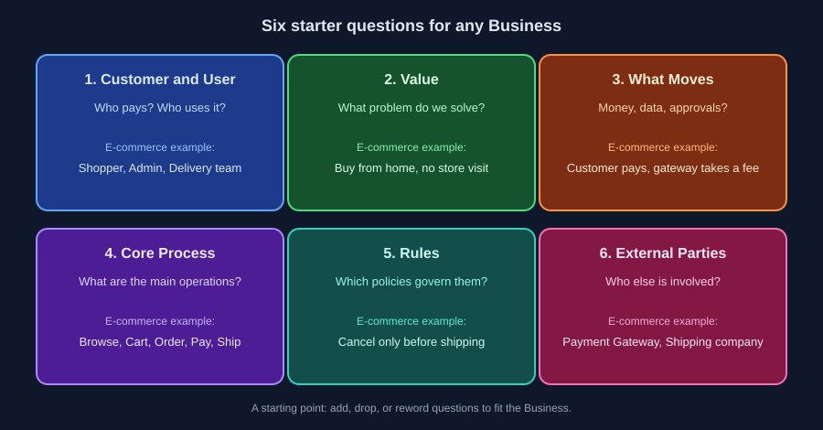

# 02: Six Starter Questions for Any Business

Reading time: 6 minutes

Here are six questions that help you start understanding any Business, whatever its field. This is not a fixed list to apply word for word. It is a starting point: add to it or drop from it depending on the Business in front of you (we cover that at the end of this file). If you can answer them, you have enough of a picture to start from.

## 1) Who Is the Customer and Who Is the User?

The Customer is who pays, and the User is who uses the system. Sometimes they are different people: in a company system, the company pays and the employees use it.

In E-commerce: the customer buys, the admin manages products, and the delivery team fulfills orders.

## 2) What Problem Do We Solve?

This is the Value: why would people use this service at all? Without a clear answer, you end up building features nobody needs.

In E-commerce: customers buy from home without going out, and merchants reach more customers than their shop could.

## 3) What Moves?

In most Businesses, what moves is money, so ask: who pays? To whom? When? And where are fees or commissions taken? This shapes Payments, Refunds, and reporting.

But not every system involves money. If it doesn't, ask the same question in another form: what moves between people and the system? It could be data, requests, approvals, or time. In an internal leave system, for example: an employee submits a request, a manager approves, and the balance is deducted. And if the app is free, still ask what funds it (ads? a sponsor?), because that affects what gets built.

In E-commerce: the customer pays, the Payment Gateway deducts a fee, and the rest reaches the merchant.

## 4) What Are the Core Operations?

The journey from start to finish: what happens from the moment the customer arrives until they receive the service.

In E-commerce: browse, Cart, Order, pay, ship, deliver.

## 5) What Rules Govern the Work?

These are the Business Rules we met in Part 01: policies for cancellation, returns, discounts, and limits.

In E-commerce: cancellation is allowed only before shipping, and returns are accepted within a certain number of days. That number is the Business's decision, not the developer's.

## 6) Who Are the Other Parties?

Any outside party the work depends on: a Payment Gateway, a shipping company, an SMS service, or legacy systems.

In E-commerce: the Payment Gateway and the shipping company.

> If you can't answer one of them, that is not a failure. It is the first line of your Question Log.

## These Questions Are a Starting Point, Not a Fixed List

Add to them or drop from them depending on the Business:

- **A question doesn't apply?** Don't leave it blank. Write "not applicable" and why, because that is itself information about the Business.
- **A question is missing?** Add it. Examples: are there laws or licenses we must follow? How much usage do we expect? What counts as success for this project?

---

Previous: [01](./01-why-business-first.md) | Next: [03: Money and the Order Journey](./03-money-and-order-flow.md)
