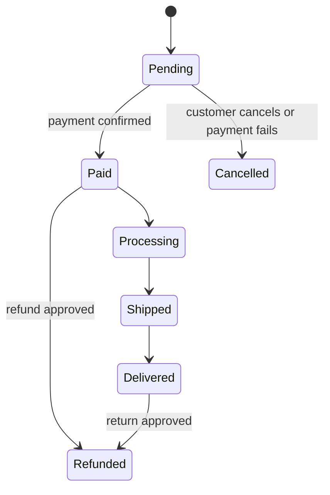

# 03: Money and the Order Journey: Applied to E-commerce

Reading time: 5 minutes

We apply questions 3 and 4 to E-commerce, because they are the questions that affect the design the most.

## How Does Money Move?

With online payment, the customer pays the Payment Gateway, and the Gateway transfers to the store after deducting its fee. With Cash on Delivery (COD), the money is collected by the courier and reaches the store later. This difference matters, because with COD the order is recorded before any money arrives.

Fees and settlement time vary by payment provider and contract, so don't assume a number.

## The Order Journey: Order Status

The best way to understand the operations is to draw the Order Statuses. Each status is a chapter in the Business's story:

These statuses are an illustrative example, and the final decision belongs to the Business.

## The Diagram Answers Part 01's Questions

Instead of asking in the air "until when can an order be cancelled?", we now have a map to ask about:

- Up to which status is cancellation allowed?
- At which transition is stock deducted?
- If payment fails, where does the order go?

Note that every Status must be agreed on, because the Frontend, the Backend, QA, and the admin will all work with it.

---

Previous: [02](./02-six-questions.md) | Next: [04: Cheat Sheet](./04-cheat-sheet.md)
