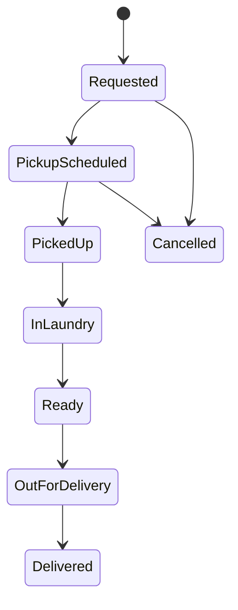

# 06: Solution

This is a model solution, not the only correct answer. If you found a point that is not listed here, that is a good sign.

## 1) The Six Questions

| Question | Answer |
|---|---|
| Customer and User | The customer orders and pays. Users: the customer, the courier, laundry staff, the admin |
| Problem solved | The customer saves time: no trip to the laundry and no waiting |
| What moves (money) | The customer pays by weight and wash type, cash to the courier or online. Monthly subscriptions are steady income, and compensation is a cost |
| Core operations | Request a pickup, pick up and weigh, wash, deliver, pay |
| Rules | Pricing by weight and type, subscription discount, compensation for damage |
| Other parties | Payment Gateway, a notification service (SMS or similar) |

## 2) Order Statuses

Note: the payment state (Paid or Unpaid) can be kept separate from the order status, because cash is collected at a different point depending on the customer's choice.

## 3) Questions for the Business

| ID | Question | Why do we need to know? |
|---|---|---|
| Q-01 | The price is set after weighing. If the customer rejects the price, is the order cancelled or does it continue? | Affects order statuses and cancellation |
| Q-02 | Up to which status is cancellation allowed? | Statuses and refunds |
| Q-03 | How is compensation calculated, and who approves it? | A financial Business Rule that needs permissions |
| Q-04 | Does the monthly subscription have a weight cap? What happens if the customer goes over it or doesn't use it all? | Defines discount calculation and rollover |
| Q-05 | When does the courier hand the collected cash to the laundry? | Affects accounting and reporting |

## 4) Extra Thinking

In an internal leave system with no money, the money question becomes "what moves?": leave requests, the manager's approval, and the leave balance that gets deducted. The remaining questions stay roughly the same: the customer is the company, the users are employees and managers, and the rules look like "leave needs approval" and "the balance cannot go negative" (examples).

## What You Took Away from This Part

- There are six starter questions for understanding any Business, and you add to them or drop from them as needed.
- Order statuses are the easiest way to see all the operations in one diagram.
- Most of the ambiguity you find is a Business decision, and its place is the Question Log.

Next part: System Design.

---

Previous: [05](./05-exercise.md) | Home: [README](../README.md)
